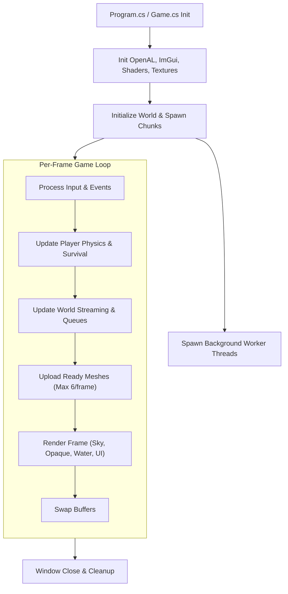
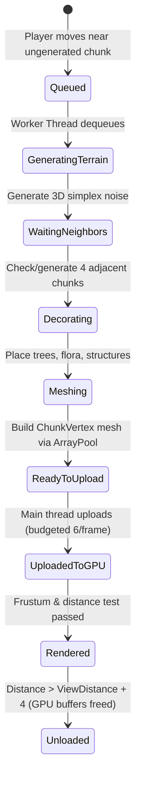
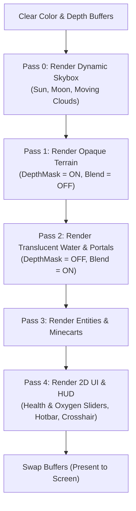

# Voxel Render Engine — Execution & System Flow

This document outlines the complete architectural flow of the program, detailing the lifecycle from application startup to frame updates, asynchronous terrain streaming, physics, rendering passes, and shutdown.

---

## 1. High-Level System Architecture



---

## 2. Program Startup Flow

1. **Entrypoint (`Program.cs`)**:
   * Creates the `Game` window configuration (resolution, title, OpenGL 3.3 Core profile).
   * Launches `game.Run()`.

2. **Initialization (`Game.OnLoad`)**:
   * **OpenGL Configuration**: Enables depth testing (`GL.Enable(EnableCap.DepthTest)`), backface culling, and smooth line rendering.
   * **Audio (`AudioManager.Init`)**: Initializes OpenAL context, listener parameters, and sound generation buffers.
   * **ImGui & UI (`UIManager.Init`)**: Prepares Dear ImGui context and HUD fonts.
   * **Graphics Assets**:
     * Compiles shader programs (`Default.vert`, `Default.frag`, `Sky.vert`, `Sky.frag`).
     * Loads the 256-block texture atlas with mipmapping and nearest-neighbor filtering.
   * **World Initialization**:
     * Instantiates `World` with seed.
     * Synchronously generates immediate $3 \times 3$ spawn chunks so player ground collision is instantly ready.
     * Starts background worker threads (`ChunkWorker-0..N`).
     * Instantiates `Player` atop spawn surface.

---

## 3. Asynchronous Chunk Streaming Flow

The chunk lifecycle is managed asynchronously across background threads and synchronized onto the main thread for GPU upload:



1. **Streaming Check (`World.StreamChunksAround`)**:
   * Evaluates chunks within `ViewDistanceChunks` (default 8 chunks radius = 17x17 area).
   * Sorts candidate chunks by distance squared to prioritize nearest chunks.
   * Enqueues up to 32 chunks per batch into `workQueue`, marking `IsGeneratingMesh = true`.
2. **Worker Threads (`World.WorkerLoop`)**:
   * Dequeue chunk coordinate from `workQueue`.
   * Throttles execution if `readyToUploadMeshes.Count >= 24` to prevent memory backlogs.
   * Generate 3D noise terrain for center and adjacent 4 neighbor chunks.
   * Apply decorations (trees, flora, structures).
   * Execute `ChunkMesher.BuildMesh()` renting arrays from `ArrayPool<T>.Shared`.
   * Push completed `ChunkMesh` to `readyToUploadMeshes` concurrent queue.
3. **Main Thread GPU Upload (`World.Update`)**:
   * Dequeues up to `maxUploadsPerFrame` (6) meshes.
   * Creates/updates single interleaved VBO and VAO on the active OpenGL context.
   * Disposes `item.mesh`, returning rented arrays to `ArrayPool`.
   * Frees GPU memory for distant chunks beyond view radius.

---

## 4. Main Loop: Update Flow (`OnUpdateFrame`)

Executed once per frame prior to rendering:

```
OnUpdateFrame(FrameEventArgs e)
 ├── 1. Process Window / Input State
 │    ├── Handle ESC (Toggle Menu / Pause)
 │    ├── Hotbar slot selection (1-9 or Scroll Wheel)
 │    └── Mouse capture & camera orientation
 ├── 2. Fluid Simulation Tick (FluidSystem.Update)
 │    └── Propagate water and lava flow to adjacent air blocks (limit: 8 blocks)
 ├── 3. Player Update (Player.Update)
 │    ├── Swept AABB Physics (Move along X, Y, Z with step-assist)
 │    ├── Minecart riding & rail tracking logic
 │    ├── DDA Raycast for block highlight, placement, and breaking
 │    └── Survival Controller:
 │         ├── Calculate fall distance & apply damage if fall >= 3 blocks
 │         ├── Check head submersion for oxygen depletion & drowning
 │         ├── Check body contact with lava for fire damage
 │         └── Passive health regeneration (after 10s without damage)
 └── 4. World Update (World.Update)
      ├── Upload ready chunk meshes to GPU & dispose pooled arrays
      ├── Stream surrounding chunks based on camera position
      └── Update dynamic entities (minecarts, portals)
```

---

## 5. Main Loop: Render Flow (`OnRenderFrame`)

The render pipeline uses a multi-pass approach to ensure correct lighting and transparency sorting:



### Detailed Render Passes:
1. **Pass 0: Skybox (`SkyRenderer.Render`)**:
   * Renders celestial hemisphere with dynamic sun, moon, and procedural moving clouds.
   * Writes background color into depth buffer.
2. **Pass 1: Opaque Terrain (`World.Render` - Pass 1)**:
   * Sets `isTranslucentPass = 0`, `DepthMask = true`, `Blend = false`.
   * Frustum-culls chunks outside camera field of view.
   * Draws opaque geometry (stone, dirt, wood, leaves, etc.).
   * Solid surfaces under water are written to depth buffer first.
3. **Pass 2: Translucent Surfaces (`World.Render` - Pass 2)**:
   * Sets `isTranslucentPass = 1`, `DepthMask = false`, `Blend = true` (`GL.BlendFunc(SrcAlpha, OneMinusSrcAlpha)`).
   * Renders water and portal quads smoothly blended over opaque geometry without clipping.
4. **Pass 3: Entities (`MinecartRenderer.Render`)**:
   * Renders active minecart models with matching lighting and texture atlas.
5. **Pass 4: User Interface (`UIManager.Render`)**:
   * Renders ImGui 2D overlays:
     * Interactive Health and Oxygen status bars positioned above the hotbar.
     * Crosshair, hotbar inventory slots, active item count.
     * Esc menu, continue/exit dialogs, and portal end-game transitions.

---

## 6. Shutdown & Disposal Flow

When the window closes (`OnUnload` / `Dispose`):
1. Background worker threads receive cancellation signals and are cleanly joined.
2. `World.Destroy()` unloads and deletes all OpenGL VBOs and VAOs from GPU memory.
3. Disposes any pending chunk meshes left in `readyToUploadMeshes` to return rented arrays to `ArrayPool`.
4. Texture atlas and shader programs are deleted via `GL.Delete*`.
5. `AudioManager.Shutdown()` frees OpenAL buffers, sources, and context.
6. ImGui controller and window resources are released.
