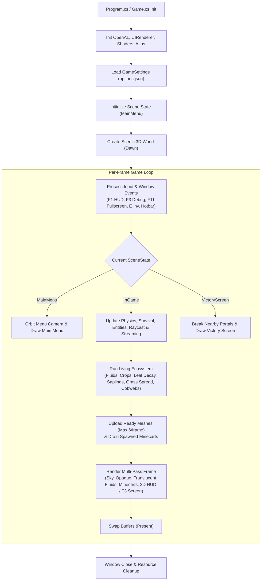
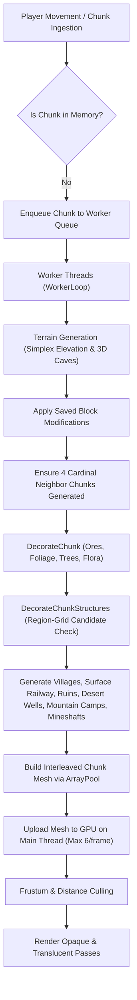
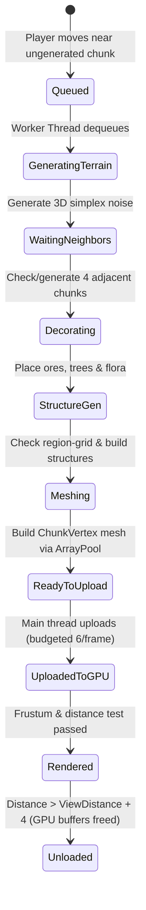
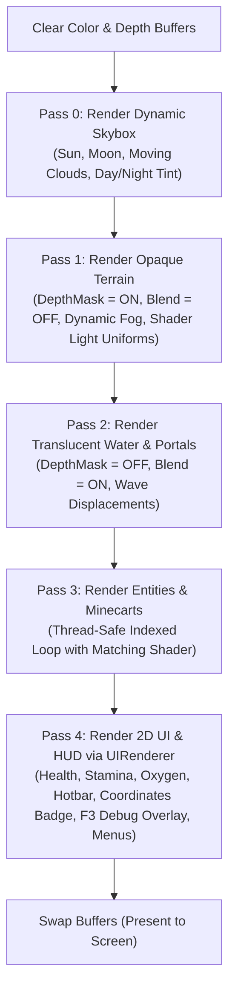
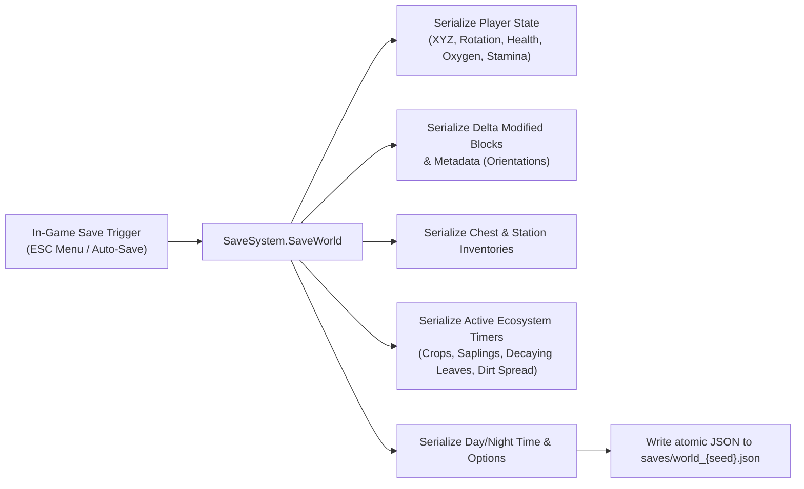

# VelmoraCraft — System Execution & Architectural Flow

This document details the complete end-to-end execution flow of the VelmoraCraft engine, tracing every lifecycle stage from process launch, scene state transitions, multithreaded terrain generation, and living ecosystem simulation, to multi-pass rendering, input handling, and shutdown.

---

## 1. High-Level System Architecture



---

## 2. Program Startup & Scene Flow

1. **Entrypoint (`Program.cs`)**:
   * Creates the `Game` window configuration (native resolution, title: *VelmoraCraft*, OpenGL 3.3 Core profile).
   * Launches `game.Run()`.

2. **Initialization (`Game.OnLoad`)**:
   * **OpenGL Configuration**: Enables depth testing (`GL.Enable(EnableCap.DepthTest)`), backface culling, and alpha blending.
   * **Audio (`AudioManager`)**: Initializes OpenAL device, listener, sound effect buffer cache, and starts background music playback.
   * **Custom UI Subsystem (`UIRenderer` & `FontRenderer`)**:
     * Instantiates the OpenGL 2D batch renderer and bitmap font glyph cache.
     * Sets up `UIManager` (HUD, pause menu, inventory, chest, furnace, crafting stations).
   * **Settings Restoration (`SaveSystem.LoadSettings`)**:
     * Reads `saves/options.json` and restores WindowState (fullscreen), HUD visibility, View Distance, and FOV.
   * **Graphics Assets**:
     * Compiles shader programs (`Default.vert`, `Default.frag`, `Sky.vert`, `Sky.frag`).
     * Loads the 256-block texture atlas with mipmapping and nearest-neighbor filtering.
   * **Scene Initialization**:
     * Creates a scenic 64-chunk 3D world locked at Dawn lighting (45s).
     * Sets `menuCamera` in an orbit looking over the landscape.
     * Sets `currentScene = SceneState.MainMenu` with active mouse cursor.

3. **Game Transitions**:
   * **Start New Game**: Destroys scenic world, creates clean world with chosen seed/size, sets player spawn atop terrain, and enters `SceneState.InGame` with grabbed mouse cursor.
   * **Continue Game**: Loads `SaveData` via `SaveSystem.LoadSaveData()`, reinstates player position, health, inventory, chests, modified blocks, and settings.
   * **Nether Portal Entry**: Triggers `SceneState.VictoryScreen`, breaks nearby portal blocks to prevent infinite reload loops, and offers "Continue Playing" or "Save & Main Menu".

---

## 3. Asynchronous Chunk Streaming & Structure Generation Pipeline



### Worker Lifecycle State Diagram:


1. **Streaming Check (`World.StreamChunksAround`)**:
   * Evaluates chunks within `ViewDistanceChunks` (2 to 16 chunks radius).
   * Sorts candidate chunks by distance squared to prioritize nearest chunks.
   * Enqueues up to 32 chunks per batch into `workQueue`, marking `IsGeneratingMesh = true`.
2. **Worker Threads (`World.WorkerLoop`)**:
   * Dequeue chunk coordinate from `workQueue`.
   * Throttles execution if `readyToUploadMeshes.Count >= 24` to prevent memory backlogs.
   * Generate 3D noise terrain for center and adjacent 4 neighbor chunks.
   * Apply decorations (ores, trees, flora) and structures (villages, railways, desert wells, camps, ruins, mineshafts). Newly spawned entities like minecarts are queued to `pendingSpawnedMinecarts`.
   * Execute `ChunkMesher.BuildMesh()` renting arrays from `ArrayPool<T>.Shared`.
   * Push completed `ChunkMesh` to `readyToUploadMeshes` concurrent queue.
3. **Main Thread GPU Upload (`World.Update`)**:
   * Dequeues up to `maxUploadsPerFrame` (6) meshes.
   * Creates/updates single interleaved VBO and VAO on the active OpenGL context.
   * Disposes `item.mesh`, returning rented arrays to `ArrayPool`.
   * Frees GPU memory for distant chunks beyond view radius.

---

## 4. Main Loop: Update Flow (`OnUpdateFrame`)

Executed once per frame prior to rendering:

```
OnUpdateFrame(FrameEventArgs e)
 ├── 1. Process Window / Input State
 │    ├── ESC: Toggle Pause Menu or close interactive stations
 │    ├── F1: Toggle HUD Visibility
 │    ├── F3: Toggle Minecraft-style Diagnostics & Coordinates Overlay
 │    ├── F11: Toggle Fullscreen Display
 │    ├── E: Open Personal Inventory & 2x2 Crafting
 │    ├── Hotbar slot selection (Keys 1-9 or Scroll Wheel)
 │    └── Mouse capture & camera look orientation (Yaw / Pitch)
 ├── 2. Living Ecosystem Simulations:
 │    ├── Fluid Simulation (FluidSystem.Update): propagate water and lava flow (limit: 8 blocks)
 │    ├── Leaf Decay Simulation: orphaned leaves disappear in 1 to 2 in-game minutes with sapling drops
 │    ├── Crop Growth Simulation: wheat advances across 7 stages to maturity in 3 to 4 in-game minutes
 │    ├── Tree Sapling Growth: planted saplings grow into full trees in 5 to 6 in-game minutes
 │    ├── Dirt-to-Grass Spread: countdown timers convert surface dirt to grass in 2 to 3 in-game minutes
 │    └── Nocturnal Cobweb Spawning: trees in loaded chunks periodically spawn cobwebs at night
 ├── 3. Player Update (Player.Update)
 │    ├── Swept AABB Physics (Move along X, Y, Z with step-assist)
 │    ├── Directional Block & Door Placement (Calculates facing from Camera.Forward)
 │    ├── Minecart riding & rail tracking logic
 │    ├── DDA Raycast for block highlight, placement, and breaking
 │    └── Survival Controller:
 │         ├── Calculate fall distance & apply damage if fall >= 3 blocks
 │         ├── Check head submersion for oxygen depletion & drowning
 │         ├── Check body contact with lava for fire damage
 │         └── Passive health regeneration (after 10s without damage)
 └── 4. World Update (World.Update)
      ├── Drain pendingSpawnedMinecarts into active Minecarts list under lock
      ├── Upload ready chunk meshes to GPU & dispose pooled arrays (budget: 6/frame)
      ├── Stream surrounding chunks based on camera position
      └── Update dynamic entities (minecarts)
```

---

## 5. Main Loop: Render Flow (`OnRenderFrame`)

The render pipeline uses a multi-pass approach to ensure correct lighting, transparency sorting, and UI layering:



### Detailed Render Passes:
1. **Pass 0: Skybox (`SkyRenderer.Render`)**:
   * Renders celestial hemisphere with dynamic sun, moon, stars, and procedural moving clouds.
   * Updates atmospheric sky tint and distance fog parameters according to current render distance and time of day.
2. **Pass 1: Opaque Terrain (`World.Render` - Pass 1)**:
   * Sets `isTranslucentPass = 0`, `DepthMask = true`, `Blend = false`.
   * Frustum-culls chunks outside camera field of view.
   * Queries active point lights (up to 15) within 48 blocks and uploads them to shader uniform arrays.
   * Draws opaque geometry (stone, dirt, wood, leaves, directional doors, etc.).
   * Solid surfaces under water are written to depth buffer first.
3. **Pass 2: Translucent Surfaces (`World.Render` - Pass 2)**:
   * Sets `isTranslucentPass = 1`, `DepthMask = false`, `Blend = true` (`GL.BlendFunc(SrcAlpha, OneMinusSrcAlpha)`).
   * Renders water, ice, and portal quads smoothly blended over opaque geometry.
   * Applies vertex wave displacement and texture frame animations in shader.
4. **Pass 3: Entities (`MinecartRenderer.Render`)**:
   * Renders active minecart models under thread-safe list lock with matching lighting and texture atlas.
5. **Pass 4: User Interface (`UIManager.Render` & `UIRenderer`)**:
   * Renders custom OpenGL 2D overlays:
     * Interactive Health, Oxygen, Stamina, and Hotbar status indicators.
     * Reticle crosshair and hand-held item rendering with bobbing animation.
     * Compact HUD Coordinates Badge (always visible in top-left).
     * Toggleable `F3` Debug Diagnostics screen with sub-block coordinates, chunk coordinates, facing direction, biome name, and engine metrics.
     * Full interactive screens: Inventory (2x2), Crafting Table (3x3), Furnace (smelting), Chest / Double-Chest, Pause Menu with persistent sliders, and Victory Screen.

---

## 6. Save & Load Architecture



* **Instant Restoration**: During world load, modified blocks are loaded into memory *before* chunks generate, ensuring user modifications appear on screen instantly without popping or delay.
* **Delta Serialization**: Unmodified chunks remain purely procedural; only player-placed, broken, or modified blocks are saved, keeping save files tiny ($< 100\text{ KB}$).

---

## 7. Shutdown & Disposal Flow

When the window closes (`OnUnload` / `Dispose`):
1. Background worker threads receive cancellation signals via `CancellationTokenSource` and are cleanly joined.
2. `World.Destroy()` unloads and deletes all OpenGL VBOs and VAOs from GPU memory.
3. Disposes any pending chunk meshes left in `readyToUploadMeshes` to return rented arrays to `ArrayPool`.
4. Texture atlas and shader programs are deleted via `GL.DeleteProgram` and `GL.DeleteTexture`.
5. `AudioManager.Dispose()` frees OpenAL sources, cached buffers, context, and audio device.
6. `UIRenderer.Delete()` frees UI shader program, font textures, and 2D quad buffers.
